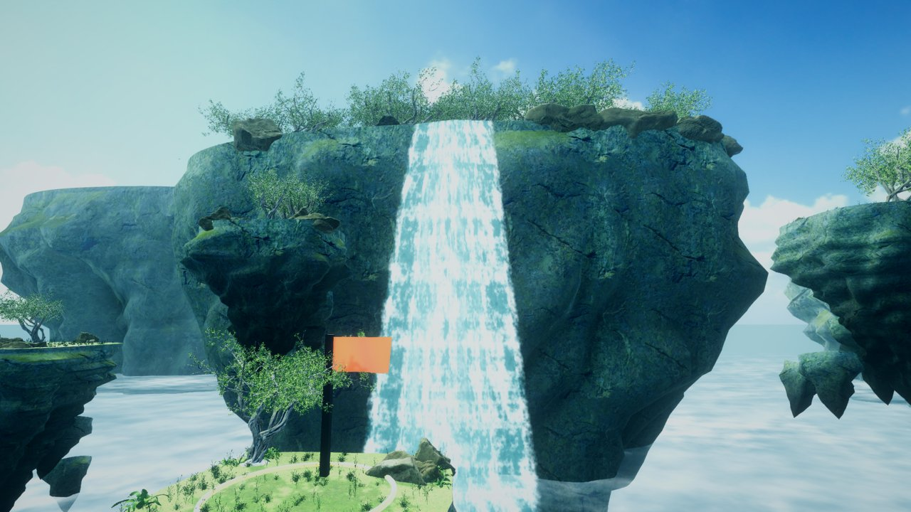
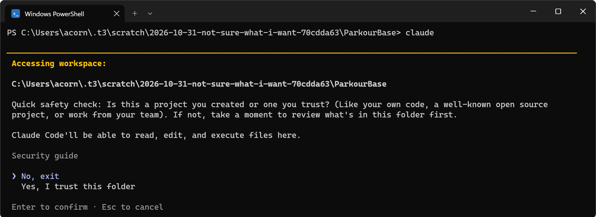
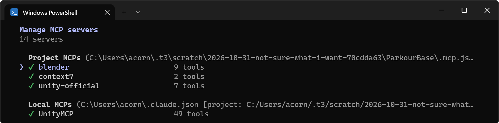
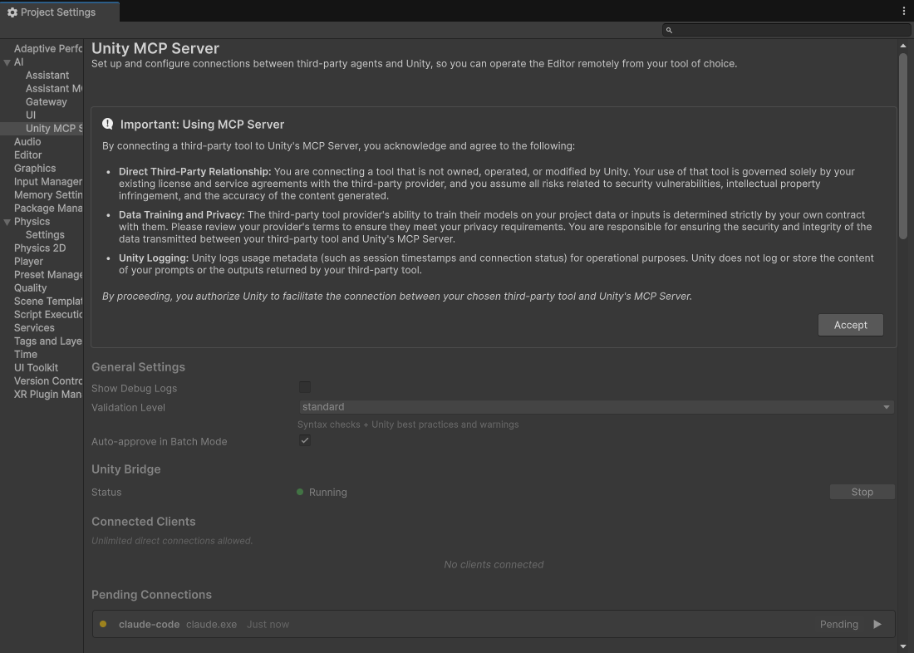
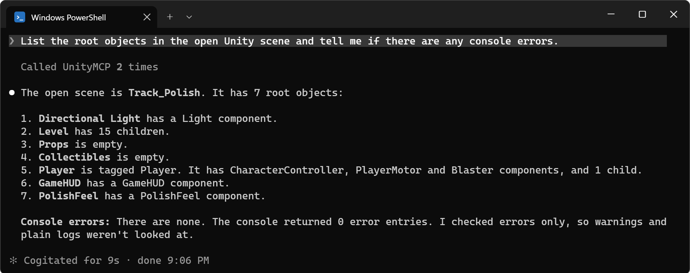
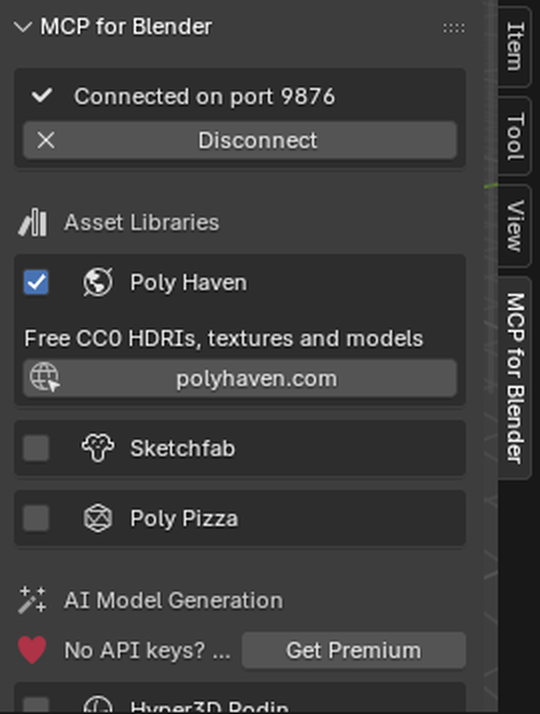

📑 **Workshop slides:** [unity-mcp-workshop-deck.pptx](docs/unity-mcp-workshop-deck.pptx) (PowerPoint, 39 MB)

# Unity MCP Workshop: ParkourBase

A tiny first-person parkour game for learning **MCP**: you talk to an AI agent (Claude Code), and it works inside your running Unity editor for you.



Everything here is **free**. You don't need any API keys.

---

## Setup (about 10 minutes)

### 1. Install Unity 6
Install **Unity Hub**, then in Hub go to **Installs → Install Editor → Unity 6 (6000.0.x)**.
- Windows / Mac: https://unity.com/download
- Linux (Ubuntu): https://docs.unity3d.com/hub/manual/InstallHub.html#install-hub-linux

The project was made with `6000.0.47f1`. Any `6000.0.x` works. If Hub warns about the version, pick **Continue**.

### 2. Download this project
- **Easiest:** green **Code** button → **Download ZIP**, then unzip it somewhere simple (e.g. `Documents`).
- **With git:**
  ```
  git clone https://github.com/ac0rdj/unity-mcp-workshop.git
  ```

### 3. Open it in Unity
Unity Hub → **Add** → **Add project from disk** → pick the folder you just downloaded → open it.
The first open takes a few minutes. Both MCP packages are already included, and the MCP server starts by itself.

### 4. Run the setup script
This installs anything missing (uv, Claude Code, and Git on Windows) and connects Claude Code to Unity, Blender and the Unity docs. It's safe to run again any time.

**Windows:** open the project folder, then open `setup` and double-click **`setup-windows.cmd`**.

**Mac / Linux:** open Terminal in the project folder and paste:
```
bash setup/setup-mac-linux.sh
```

Every line should show ✔ / `[ok]`. A `!` is a tip, not an error. If anything shows ✘ / `[x]`, fix what it says and run the script again.

> **Port already in use?** The script will tell you. Run it again with another port (`--port 8092` on Mac/Linux, `setup-windows.cmd -Port 8092` on Windows), then type the same URL (`http://127.0.0.1:8092`) into **Window → MCP for Unity**.

### 5. Start Claude Code
Open a **new** terminal in the project folder:
```
claude
```
The first time, it asks you to log in, then asks if you trust the folder. Pick **Yes, I trust this folder**.



Type `/mcp`. You should see `UnityMCP`, `unity-official`, `blender` and `context7` with ✔:



### 6. Unity's own MCP: approve it once
The first time Claude connects, Unity asks you to approve it: **Edit → Project Settings → AI → Unity MCP Server**, click **Accept** on the notice, then approve Claude under **Pending Connections**.



### 7. Say hi
Type (or say, with voice dictation):
```
List the root objects in the open Unity scene and tell me if there are any console errors.
```
If it reads your scene back, you're ready. 🎉



---

## Optional: Blender (Art track)
1. Install Blender from https://www.blender.org/download/ and open it once.
2. Run the setup script again. It installs the Blender add-on.
3. In Blender: **Edit → Preferences → Add-ons**, search `MCP`, tick **Interface: MCP for Blender**.
4. In the 3D view press **N** → **MCP for Blender** tab → tick **Poly Haven** → **Start MCP Server**.



Poly Haven gives you free CC0 models, textures and skies with no account.

---

## Troubleshooting
| Problem | Fix |
|---|---|
| `claude` / `uv` "not found" right after setup | Close the terminal and open a new one, so it picks up the newly installed tools. |
| `UnityMCP` ✘ in `/mcp` | Keep Unity open. **Window → MCP for Unity** should say *Session Active*. If not, click **Start Server**. |
| `unity-official` missing | Open the project in Unity once (that installs Unity's relay), then run the setup script again. |
| `unity-official` ✘ | Approve Claude under **Project Settings → AI → Unity MCP Server → Pending Connections**. |
| `blender` ✘ | Blender must be open with **Start MCP Server** clicked (port 9876). |
| Windows: "running scripts is disabled" | Use `setup-windows.cmd`. It runs the script without changing your settings. |
| Mac: "permission denied" on the script | Run it with `bash setup/setup-mac-linux.sh` (don't use `./`). |

### Manual setup (if you'd rather not run a script)
Run these in the project folder after installing [uv](https://docs.astral.sh/uv/getting-started/installation/) and [Claude Code](https://code.claude.com/docs/en/setup):
```
claude mcp add --transport http UnityMCP http://127.0.0.1:8080/mcp
claude mcp add --transport http context7 https://mcp.context7.com/mcp
claude mcp add blender -- uvx mcp-for-blender
```
Then add Unity's official relay with the line for your computer:
```
# Windows (PowerShell)
claude mcp add unity-official -- "$env:USERPROFILE\.unity\relay\relay_win.exe" --mcp
# Mac (Apple Silicon)
claude mcp add unity-official -- ~/.unity/relay/relay_mac_arm64.app/Contents/MacOS/relay_mac_arm64 --mcp
# Mac (Intel)
claude mcp add unity-official -- ~/.unity/relay/relay_mac_x64.app/Contents/MacOS/relay_mac_x64 --mcp
# Linux
claude mcp add unity-official -- ~/.unity/relay/relay_linux --mcp
```

---

## The game
Open `Assets/Scenes/Parkour.unity` and press Play.

| Input | Action |
|---|---|
| WASD | Move |
| Space | Jump |
| Left click | **Blast** yourself in the direction you're looking (1 charge, recharges on landing) |
| R | Restart |
| Esc | Free the cursor (click to recapture it) |

**Course:** warm-up jumps → checkpoint → long gap (jump, then blast forward and slightly up) → wall (jump, then blast upward) → checkpoint → final gap to the flag.

### Project map (useful when prompting an agent)
| Thing | Where |
|---|---|
| Movement | `Assets/Scripts/PlayerMotor.cs` (keeps momentum in the air) |
| Blast ability | `Assets/Scripts/Blaster.cs` (`blastSpeed`, `upwardBias`, `maxCharges`) |
| Timer / HUD | `Assets/Scripts/GameHUD.cs` (IMGUI, no UI packages) |
| Checkpoints / finish | `Checkpoint.cs`, `Goal.cs` |
| Level layout | Scene objects under `Level`. You can regenerate it from code with **Parkour › Rebuild Parkour Scene** (`Assets/Editor/LevelBuilder.cs`). ⚠️ Rebuilding overwrites manual edits. |
| Empty slots for you | `Props` (scenery) and `Collectibles` (coins etc.) |
| MCP demo scene | `Assets/Scenes/RockDemo.unity`: a grass plane and an empty `Rocks` object |
| Track examples | `Assets/Scenes/Examples/`: `Track_Art` (sky islands + waterfall), `Track_Mechanics`, `Track_Polish` |

### Challenge ideas
- 🎨 **Art:** fill `Props` with scenery from Poly Haven (through Blender MCP), add a skybox, lighting and mood.
- ⚙️ **Mechanics:** coins in `Collectibles` with a score on the HUD, a double blast (`maxCharges = 2`), moving platforms, a new course section.
- 🧹 **Polish:** tune the jump and blast feel, add blast sound and particles, add a best-time save.

Starter prompts: [DEMO-PROMPTS.md](DEMO-PROMPTS.md).

## Credits
3D models, textures and the sky are CC0 from [Poly Haven](https://polyhaven.com). MCP servers: [MCP for Unity](https://github.com/CoplayDev/unity-mcp), Unity AI Assistant (official MCP), [MCP for Blender](https://pypi.org/project/mcp-for-blender/), [Context7](https://context7.com).
